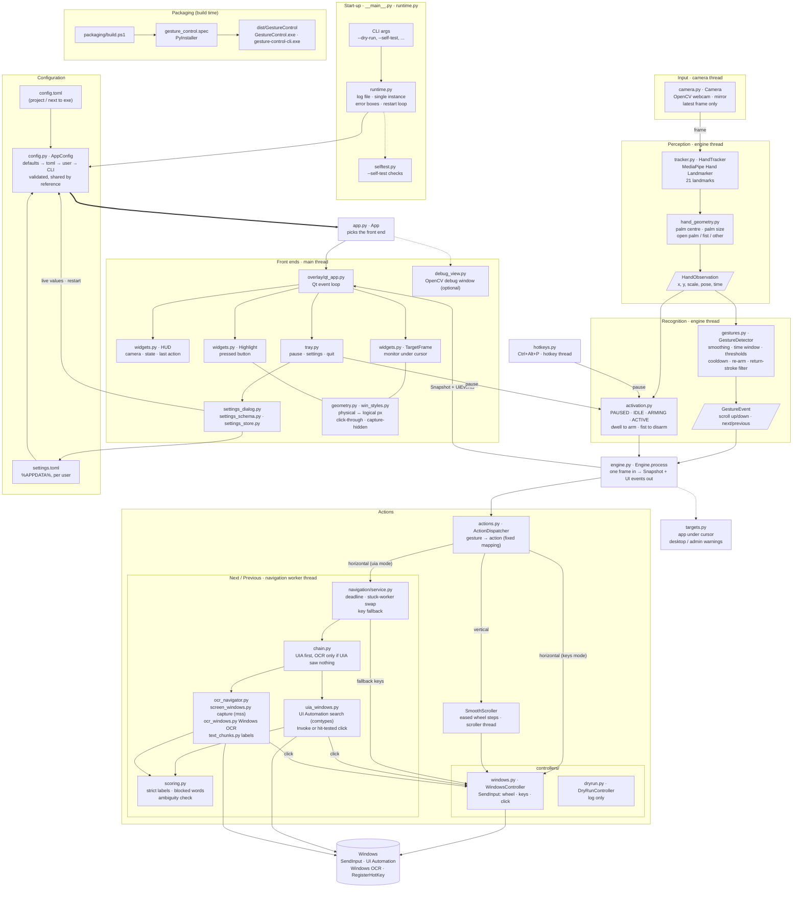

# Architecture

How Gesture Control is put together. The diagram shows components at module
level: what each one does, which data passes between them, and which thread it
runs on. GitHub renders the diagram; locally, use any Mermaid viewer.

## Threads

| Thread | Runs | Talks to others through |
|---|---|---|
| Main (Qt) | overlay, tray, settings window | reads the latest `Snapshot`, drains UI events |
| Engine | tracker → detector → activation → dispatcher | `Snapshot` slot, event queue |
| Camera | `Camera` frame grabbing | latest-frame slot with a condition variable |
| Navigation worker | UI Automation / OCR search and pressing | job queue in, result queue out |
| Scroller | smooth wheel animation | animation list under a lock |
| Hotkey | `RegisterHotKey` message loop | calls `toggle_pause` |

## Main data types

| Type | Defined in | Produced by → consumed by |
|---|---|---|
| `HandObservation` | `types.py` | tracker → gesture detector, activation |
| `GestureEvent` | `types.py` | gesture detector → engine → dispatcher |
| `Snapshot`, `UiEvent` | `engine.py` | engine → front ends |
| `UICandidate`, `Rect` | `navigation/candidates.py` | UIA / OCR → scoring |
| `NavigationAttempt` / `NavigationResult` | `navigation/__init__.py`, `service.py` | navigators → service → engine |
| `AppConfig` | `config.py` | config files + CLI + settings window → every stage |
